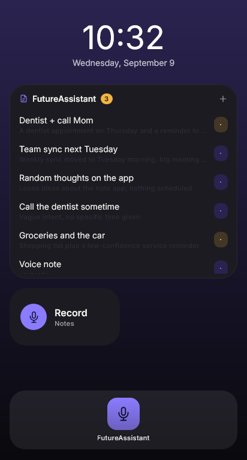
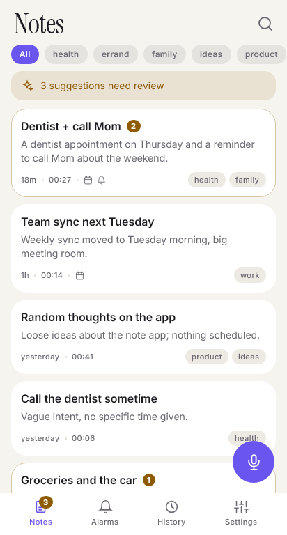
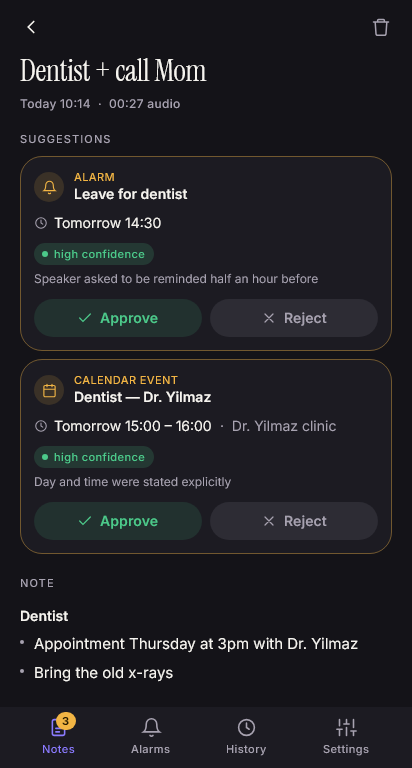
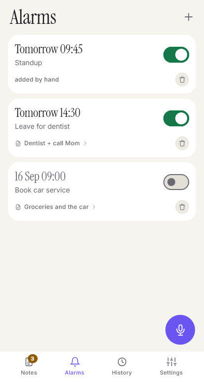
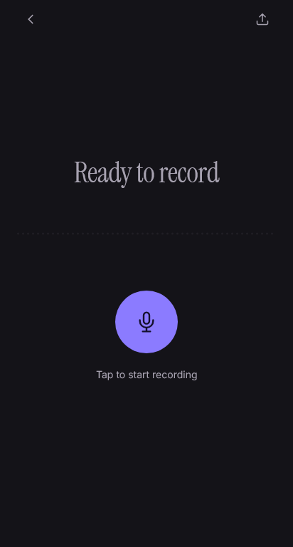

# FutureAssistant

**Speak a thought; get back a clean note, plus the alarm or calendar event it implies, and nothing is set until you approve it.**

FutureAssistant is an Android voice-notes app. You record a short voice note, and
it comes back as a structured note: a title, a summary, tags, to-dos and, when
you actually said a time, a suggested alarm or calendar event. Each suggestion
shows *why* the model proposed it, and nothing touches your alarms or calendar
until you tap **Approve**.

<p align="center">
  
  
  
</p>
<p align="center">
  
  
</p>

> This repository is a project overview. The source code is kept private.

---

## How it works

```
voice ─▶ Groq Whisper ─▶ transcript ─▶ DeepSeek ─▶ { note, alarms, events } ─▶ you approve ─▶ device + calendar
```

1. **Record.** Tap the mic in the app or on the home-screen widget. Recordings
   are short by design (3 minutes by default) because this is a notebook for quick thoughts,
   not a meeting recorder.
2. **Transcribe.** The audio goes to a self-hosted n8n backend, which sends it to
   Groq's Whisper for speech-to-text.
3. **Structure.** The transcript goes to DeepSeek with a strict JSON contract and
   comes back as a title, summary, markdown body, tags, action items, and any
   alarms or calendar events, each with a confidence score and a reason.
4. **Approve.** Suggestions appear on the note. Approved alarms are scheduled on
   the device, and approved events go into the phone's own calendar.

## Design principles

- **The app suggests; you decide.** By default, alarms are not set and events are not written.
  An optional auto-approve setting exists, but it stays off for any note the app is unsure about.
- **Empty is the right answer most of the time.** The worst failure for an app like this
  is turning "I should call the dentist sometime" into a 3 AM alarm. The prompt
  is built to leave `alarms` and `events` empty unless a time was actually stated.
  The negative test case (rambling with no time in it) matters more than the
  positive one.
- **Keeping beats losing.** Throwing away a real note destroys something the user
  said only once, while keeping an extra junk note costs nothing. So every filter
  leans toward keeping: deletion is soft everywhere, restoring a backup merges
  instead of overwriting, and a note that may be background chatter is still
  created but flagged with a question rather than silently dropped.
- **Measured, not assumed.** Several sensible-looking choices were reversed after
  testing on a real device. For example, "louder audio means the speaker was close
  to the phone" turned out to be false, because automatic gain control erases
  distance. That hint was removed from the prompt.

## Features

- Voice-to-note pipeline with timestamps resolved against *when you spoke*, not
  when the upload happened (queued recordings keep their capture time)
- Offline upload queue: record without a network, and the note is processed when the connection comes back
- In-app alarms through `AlarmManager.setAlarmClock`: full-screen ringing, snooze,
  and they survive Doze and reboots
- Calendar events written to the user's own device calendar
- Home-screen widgets (Jetpack Glance): one-tap recording, plus a notes widget
  where you can approve alarms, delete notes and undo
- Background-speech detection: notes that look like overheard conversation are
  flagged for a decision instead of being trusted blindly
- Note lifetimes: old notes age out automatically, unless an upcoming alarm is attached to them
- History of every change, soft delete with restore, and JSON backup/restore
- Light and dark themes, with English and Turkish UI

## Architecture

```
┌─ Android app ─────────────────────────────────────────────┐
│  Record screen · Glance widgets                           │
│        │                                                  │
│        ▼                                                  │
│  Upload queue ──(multipart + per-user API key)──┐         │
│                                                 │         │
│  Notes · Alarms (AlarmManager) · Calendar ◀── structured JSON
└─────────────────────────────────────────────────┼─────────┘
                                                  │ HTTPS (Caddy, auto-TLS)
┌─ n8n backend (Docker, self-hosted) ─────────────▼─────────┐
│  Webhook → Guard (key + rate limit) → Whisper → DeepSeek  │
│          → Validate & Normalize → Respond                 │
└───────────────────────────────────────────────────────────┘
```

- **All AI keys stay on the server.** The phone never holds the Groq or DeepSeek keys. When a
  model name changed upstream, the fix was a single node in n8n, with no app release needed.
- **Per-user API keys with rate limits.** Each key can be revoked on its own,
  and the rate limit protects the AI provider budget from a leaked key. If no keys are configured,
  the guard fails *closed*.
- **One contract, validated twice.** The n8n `Validate & Normalize` node and the
  Kotlin parser apply the same rules, and the same test scenarios run against both.

## Tech stack

| Layer | Technology |
|---|---|
| App | Kotlin, Compose Multiplatform (Android + desktop target) |
| Widgets | Jetpack Glance |
| Persistence | Plain JSON files + SharedPreferences (single user, hundreds of notes, so no Room needed) |
| Backend | n8n workflows in Docker, behind Caddy |
| Speech-to-text | Groq Whisper |
| Structuring | DeepSeek (JSON output) |
| Tests | 270+ unit and UI tests: Kotlin common, Android unit, and Compose desktop layout and screenshot tests, plus Node tests for the backend logic |

The screens live in shared code, so the whole UI also runs on desktop inside a
phone-sized window. That target is used for layout regression tests and for
rendering the screenshots above. It is a test tool, not a product.

## Status

Works end to end and has been tested on real devices. The app is distributed
directly as signed APKs, not through an app store.

---

© 2026 Yusuf Güven İğdir. All rights reserved.
This repository is shared for viewing only. No license is granted to use, copy,
modify, or distribute any part of it.
